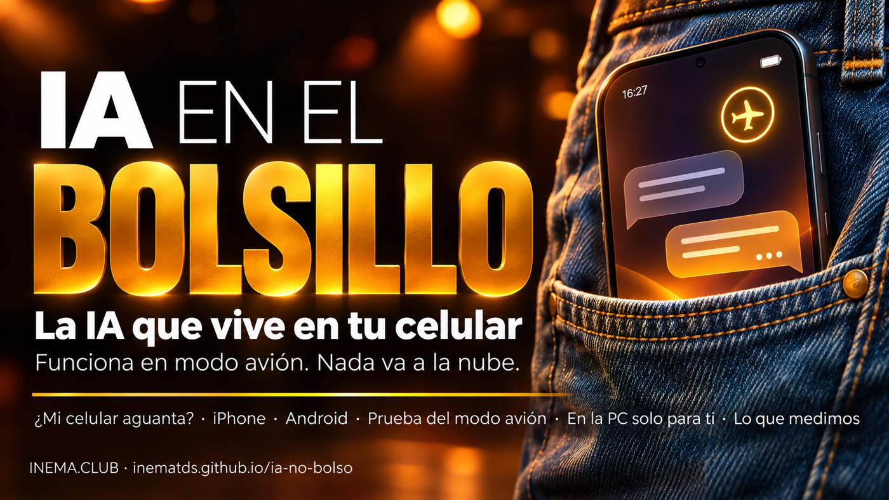

# IA en el bolsillo

[](https://inematds.github.io/ia-no-bolso/guia/es/)

**🇧🇷 [Português](README.md) · 🇺🇸 [English](README.en.md) · 🇪🇸 [Español](README.es.md)**

## Qué es

Cuando usas la IA de una aplicación común, la pregunta sale del celular y llega al servidor de una empresa. **IA en el bolsillo** es lo contrario: un modelo pequeño y abierto (LFM3 1.7B, en una versión sin censura) que descargas una vez y funciona dentro del dispositivo, incluso en modo avión. Sirve para quienes quieren privacidad y no quieren escuchar «no puedo responder» ante una pregunta normal. Esta guía muestra si tu celular puede ejecutarlo, el paso a paso en iPhone y Android, y un kit gratis para correr el mismo modelo en la computadora.

## 📖 Guía de uso

Guía completa (landing + paso a paso): **https://inematds.github.io/ia-no-bolso/guia/es/**

📱 **Pruébalo en el celular sin instalar nada:** https://inematds.github.io/ia-no-bolso/celular/?lang=es — abre en el navegador, descarga 1,1 GB una vez y luego funciona en modo avión (probado en Chrome simulando Android y en un celular real el 14/11/2026). Consejo: después de encender, usa "Agregar a la pantalla principal" y queda como app con ícono.

---

**Todo lo que le preguntas a la IA del celular termina en el computador de una empresa. Y a veces hasta se niega a responder una pregunta normal.**

La **IA en el bolsillo** es una IA que vive dentro de tu celular: funciona en modo avión, no envía nada a la nube y no rechaza preguntas normales. Este kit te dice si tu dispositivo puede con ella, muestra paso a paso cómo usarla en iPhone y Android, ejecuta el mismo modelo en tu computador solo para ti y mide la velocidad y los rechazos con tus preguntas.


## El modelo

| | |
|---|---|
| Modelo | **LFM3 1.7B**, de Liquid AI (abierto, licencia LFM Open License v1.0) |
| Versión sin censura | [`AtomicChat/LFM3-1.7B-Uncensored-GGUF`](https://huggingface.co/AtomicChat/LFM3-1.7B-Uncensored-GGUF) |
| Tamaño | **1,13 GB** (Q4_K_M) o 1,59 GB (Q6_K) |
| Qué hace | **solo texto** (el repositorio no incluye la parte de imagen) |
| Según quien lo publicó | rechazos a solicitudes nocivas 61,7% → 0%; falsos rechazos 5,2% → 0%; MMLU 41,0% → 41,0% |

El kit **no** incluye el archivo del modelo: se descarga directamente de Hugging Face. Lee la licencia de Liquid AI antes de usarlo.

## En 1 minuto

```bash
git clone https://github.com/inematds/ia-no-bolso && cd ia-no-bolso
python3 kit/escolher.py --sistema iphone --ram 8      # ¿mi celular puede con ella? ¿qué archivo?
bash kit/pc/rodar.sh                                   # en el PC: compila llama.cpp, descarga 1,1 GB, inicia en 127.0.0.1:18431
python3 kit/medir.py                                   # velocidad + rechazos con 5 preguntas normales
python3 kit/testes/run.py                              # 23 pruebas del kit, sin red
```

## En el celular (paso a paso completo en [kit/CELULAR.md](kit/CELULAR.md))

- **iPhone** — app **OnDevice: Local AI Studio** (App Store, iOS 18+). Modelos → búsqueda de Hugging Face → `atomic chat` → **LFM3-1.7B-Uncensored-GGUF** → descargar → cargar → preguntar. Funcionó en un iPhone 16 (26 tokens/s en un 16 Pro Max, en la prueba mostrada). PocketPal **no** cargó este archivo.
- **Android** — app **Layla** (importa GGUF). **Aún no está confirmado** con este archivo: pruébala. Si no abre, usa la alternativa: `LiquidAI/LFM3-1.7B-GGUF` (versión normal, con restricciones).
- **Prueba de privacidad:** después de descargar, activa el **modo avión** y haz una pregunta. Si responde, todo está en el dispositivo.

## Qué medimos (13/11/2026)

Sin un celular de prueba, ejecutamos en el PC **solo con el procesador, 4 núcleos** (lo más parecido a un celular), con la máquina ocupada:

| Medición | Resultado |
|---|---|
| Ollama 0.33.2 | **no abrió** el archivo ("failed to validate GGUF") |
| llama.cpp `5676dfb` (13/11) | abrió |
| Generación (`llama-bench`) | ~14–21 tokens/s |
| `kit/medir.py` (5 preguntas normales) | promedio **19,8 tokens/s**, **0 rechazos** |
| Detalle | **piensa en inglés** antes de responder: una respuesta larga tarda 1–3 min |

> ⚠️ **El hallazgo más importante:** preguntamos dos veces cuál es la dosis máxima de paracetamol. En la 1.ª respondió **"4 g por dosis"** (incorrecto y peligroso: el límite habitual es 4 g **por día**). En la 2.ª acertó. Un modelo pequeño es una lotería: **en temas de salud, derecho y dinero, consulta con un profesional.** Respuestas completas en [exemplo/](exemplo/).

## Archivos

| Archivo | Para qué sirve |
|---|---|
| `kit/escolher.py` | ¿Mi celular puede con ella? Indica el archivo, la app y el contexto según la memoria y el espacio libre |
| `kit/pc/rodar.sh` | Compila llama.cpp (solo CPU), descarga el modelo y comprueba el tamaño, inicia **solo en 127.0.0.1** |
| `kit/medir.py` | Mide tokens/s, tiempo y rechazos; se niega a comunicarse con direcciones que no sean locales |
| `kit/provas/perguntas.json` | 5 preguntas normales (incluye 2 de «falso rechazo»); cámbialas por las tuyas |
| `kit/modelos.json` | Archivos, tamaños, apps y alternativa, verificados el 13/11/2026 |
| `kit/CELULAR.md` | Paso a paso para iPhone y Android, con la prueba del modo avión |
| `kit/USO-RESPONSAVEL.md` | Reglas: sin censura = la responsabilidad es tuya |
| `exemplo/` | Nuestras mediciones y respuestas sin procesar |

## Kits hermanos

- [ia-privada-3-niveis](https://inematds.github.io/ia-privada-3-niveis/guia/) — IA privada en el computador (normal o sin censura), accesible desde cualquier lugar mediante Tailscale.
- [ia-sem-censura-defensiva](https://github.com/inematds/ia-sem-censura-defensiva) — usar un modelo sin censura para defenderse, no para atacar.
- [provedores-semcensura](https://github.com/inematds/provedores-semcensura) — cuando no se puede ejecutar localmente.

Más kits gratis en **[inema.club](https://inema.club)**.

## Licencia

Kit: MIT. Modelo: LFM Open License v1.0 (Liquid AI) — no incluido en este repositorio.